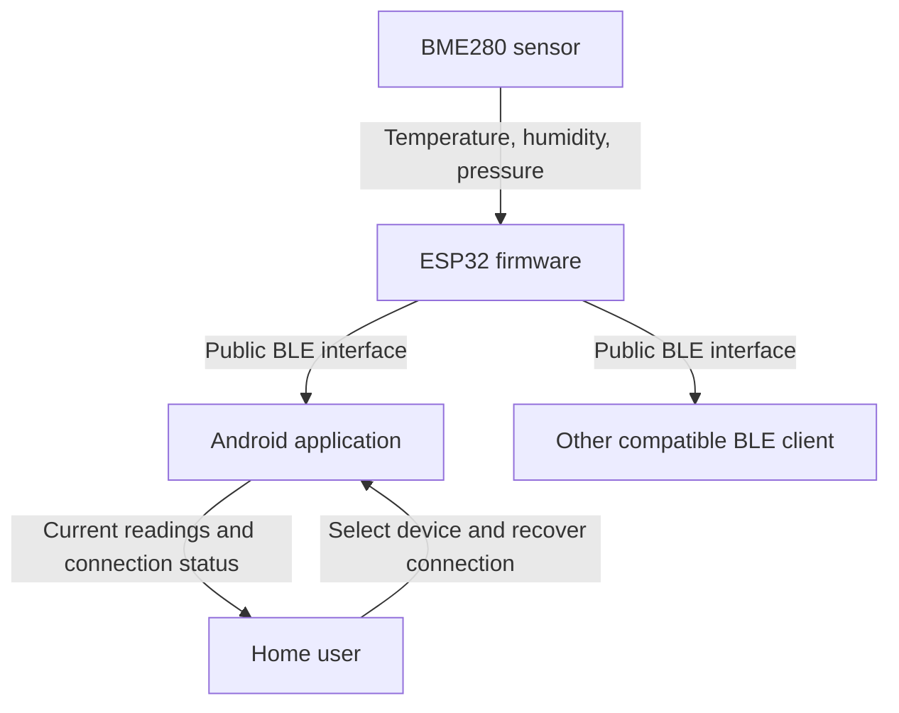

# Air Quality Monitor — Architecture

## Status and Sources

This documentation defines the target MVP architecture. The repository currently
contains a scaffold, not an implementation of the complete design. Product behavior
is defined by the [vision](../product/vision.md),
[requirements](../product/requirements.md), and
[user flows](../product/user-flows.md). Requirement identifiers below refer to those
requirements; architecture documents explain how responsibilities support them.

| Document | Contents |
| --- | --- |
| [Firmware architecture](firmware.md) | Sensor acquisition, scheduling, validity, current snapshot, BLE publication, and device reliability. |
| [Android architecture](android.md) | Presentation, session ownership, BLE access, selection persistence, freshness, and recovery. |

## System Context

The reference device uses continuous external power. Firmware measures temperature,
relative humidity, and atmospheric pressure every five seconds, independently of
phone connections. The Android application supports API 24 and later on BLE-capable
phones and displays current values only while connected in the foreground.

The ESP32 is the BLE peripheral and measurement source; Android is the client.
Another compatible client can use the same documented public interface without
application-specific interpretation. Concurrent clients are not required.

## Boundaries and Data Flow

1. Firmware acquires sensor readings on the fixed five-second schedule and records
   each measurement's validity in an in-memory current snapshot.
2. BLE publication exposes current measurements and validity without coupling
   acquisition to the lifetime or responsiveness of a client.
3. Android discovers compatible devices, remembers one selection, and owns one
   active connection session while in the foreground.
4. The Android data layer accepts updates from that session, applies validity and
   freshness rules, and exposes connection and measurement state to presentation.
5. Presentation formats valid values and provides discovery and recovery actions.

The conceptual public interface must communicate the three measurements, their
units, validity, and five-second update cadence. Discovery must identify compatible
devices and provide enough identity information for selection and later
reconnection. Identifiers, identity representation, payload encoding, and whether
updates use reads, notifications, or a combination require a separate BLE
specification under DOC-04. No wire format is established by this document.

Fresh delivery must not turn an old cached sample into a current reading. The BLE
specification must define how a client avoids accepting an outdated snapshot as
fresh, including immediately after connection or when sensor acquisition fails.

## Lifecycle, Privacy, and Failure Boundaries

- Device sampling continues when no phone is connected. Leaving the application
  foreground stops Android BLE updates, discovery, connection attempts, and the
  connection; returning resumes connection to the remembered device (CONN-02–03).
- Connection status and measurement availability are separate. A connection can
  succeed while all measurements remain unavailable (CONN-04).
- Invalid measurements are unavailable immediately; each reading also expires
  after 15 seconds without a valid update. Disconnecting or changing devices clears
  measurements, and reconnecting requires new valid updates (MEAS-03–04).
- Both components retain measurements only transiently in memory. They provide no
  measurement files, databases, persistent measurement logs, history, or uploads.
  Android may persist the selected device's identity (DATA-02–03).
- Runtime operation needs no internet, account, backend, or third-party service.
  Downloading build tools or software is separate from runtime operation (DATA-01).
- BLE measurements are readable without pairing or authentication. Nearby
  compatible clients can read them; remembering a device does not establish an
  exclusive or authenticated relationship (CONN-06).

The MVP has no backend, remote access, background monitoring, notifications,
in-app device configuration, additional sensors, other app platforms, or
simultaneous monitoring of multiple devices. Future extensions in the vision do
not introduce components into this architecture.

## Current Implementation and Follow-up Specifications

| Area | Current repository state | Target gap |
| --- | --- | --- |
| Firmware | ESP-IDF CMake project, ESP32 target, NimBLE enabled in `sdkconfig`, empty `app_main`. | Sensor integration, acquisition, validity, BLE service, and recovery behavior. |
| Android | Kotlin/Compose application with navigation, ViewModel/Flow state, and a repository emitting placeholder strings. | Device discovery, BLE sessions, typed measurement state, foreground ownership, selection storage, and monitoring UI. |

Existing scaffolding is evidence of the technology direction, not evidence that
measurement or connection requirements are already met. Logical components in
these documents do not mandate separate build modules or one class per component.

Follow-up specifications must define the exact reference board/module, power and
wiring, sensor bus and driver, reproducible tool versions and build/setup commands,
public BLE contract, retry timing and operation timeouts, and selected-device
storage mechanism. These details remain open; this architecture does not choose
them implicitly.

Verification follows the acceptance scenarios in the requirements: normal live
viewing, partial sensor failure and stale data, connection loss, foreground return,
restart and device switching, Bluetooth and permission recovery, compatible-client
access, offline operation, storage inspection, and seven-day device reliability.
