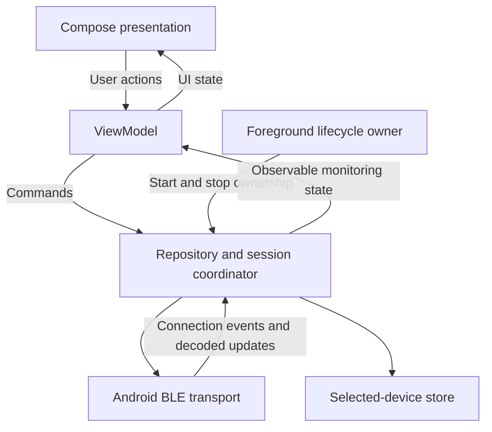

# Android Application Architecture

## Status and Direction

This is the target MVP design; see the [system architecture](README.md),
[product requirements](../product/requirements.md), and
[user flows](../product/user-flows.md). The application supports API 24 and later
on BLE-capable phones.

The repository already uses Kotlin, Compose, ViewModel, and Flow. Its current
`DataRepository` emits placeholder strings, and the main screen displays greetings.
The existing loading/success/error state is a scaffold, not the monitoring state
model. BLE access, selection persistence, and measurement handling are absent.

## Logical Components and Dependencies

| Responsibility | Boundary |
| --- | --- |
| Compose presentation | Render candidates, connection status, available measurements, and recovery actions; request permissions or system interaction through the Android UI layer. |
| ViewModel | Turn user actions into commands and map observable monitoring state to display state without owning platform BLE callbacks. |
| Repository and session coordinator | Own selection, discovery/connection transitions, retry work, active-session validation, and measurement freshness. Expose observable state through Flow/StateFlow. |
| BLE transport | Isolate Android discovery and GATT operations, callback handling, public-contract decoding, and resource cleanup. Report platform failures to the coordinator. |
| Selected-device store | Persist only the chosen device identity needed for reconnection; expose it independently of transient measurement state. |
| Foreground lifecycle owner | Explicitly grant or revoke permission to run discovery, connection attempts, and the active session as the app enters or leaves the foreground. |

Keep these as logical responsibilities within the existing app module. No separate
domain module, dependency injection framework, or persistence library is required
by this design. Concrete interfaces and types will replace the placeholder string
repository during implementation.

## State and Live Measurements

Monitoring state separates three concerns rather than treating every issue as a
single terminal error:

- Selection and discovery: remembered identity, discovered compatible candidates,
  and discovery progress or failure.
- Connectivity and prerequisites: connecting, connected, disconnected, and
  connection failure, plus unsupported BLE, disabled Bluetooth, or missing
  permissions that explain why an operation cannot proceed.
- Measurements: independent availability and values for temperature, humidity,
  and pressure, with transient freshness bookkeeping for each field.

The BLE transport decodes according to the public contract, not display-specific
assumptions. The coordinator accepts updates only for the current selected device
and active connection. Late callbacks from a released connection or a previous
device cannot repopulate state.

On connection, all readings remain unavailable until new valid updates arrive.
An invalid update makes its affected reading unavailable immediately. Valid updates
refresh per-field freshness; after 15 seconds without a valid update, that field
becomes unavailable even if the BLE connection remains established. Use elapsed,
monotonic time for this transient interval so wall-clock changes cannot extend it.
The public contract must prevent a cached device sample from being mistaken for
a new valid update (MEAS-03–04).

Presentation formats temperature in °C and humidity in % to one decimal place,
and pressure in hPa as an integer. Firmware measures and connected foreground
viewing refreshes every five seconds; unavailable fields never use a substituted
zero. No comfort bands, scores, or health interpretation are added (MEAS-01–02).

## Foreground Ownership and Connection Lifecycle

1. On foreground entry, load the remembered selection and evaluate Bluetooth and
   permission prerequisites. Without a selection, allow compatible-device discovery
   and user selection; otherwise attempt automatic reconnection.
2. Persist a chosen identity and connect to that one device. Discovery candidates
   must be clearly identifiable. Pairing and phone authentication are not required.
3. While connected in the foreground, consume valid updates and run freshness
   expiration independently of whether updates continue arriving.
4. On connection loss, immediately clear measurements, report disconnection, and
   attempt reconnection while foreground ownership and prerequisites allow it.
   Failed attempts expose understandable failure and retry actions.
5. On a device change, invalidate the previous session, cancel its pending work,
   release its connection, clear measurements, and connect to the new selection.
6. On foreground exit, stop discovery and updates, cancel connection attempts and
   retries, invalidate the session, release the BLE connection, and clear readings.
7. On return or process restart, reconnect to the remembered selection and wait
   for fresh measurements. There is no replay of missed or previously shown values.

Foreground cleanup must be explicit. A ViewModel lifetime or Compose state
subscription is not sufficient ownership for BLE work. In particular, the current
`SharingStarted.WhileSubscribed(5000)` timeout must not delay cleanup after
foreground exit. Rotation or recomposition must not create competing session
owners; exact lifecycle wiring belongs to implementation (CONN-02–03).

## Recovery and Persistence Boundaries

| Condition | Application behavior |
| --- | --- |
| Unsupported BLE | Explain the limitation; connection requires a supported phone. |
| Bluetooth disabled | Stop affected BLE work, clear readings if disconnected, and offer an enable action. |
| Permission missing or denied | Explain the required access and offer permission or settings recovery; do not enter a permanently failed state. |
| No compatible devices found | Show the empty outcome and offer rescan after checking power and range. |
| Connection failure or device unavailable | Show failure and offer retry; preserve the selection for automatic foreground reconnection. |
| Invalid or expired measurement | Keep connection status separate, show the affected field as unavailable, and recover on valid updates. |

Re-evaluate prerequisites after permission or system-setting changes. Cancellation
must also reject late results so stopped scans or connections do not resume work
after foreground exit. Retry timing, operation timeouts, and platform-version
permission details require implementation specifications; this document does not
assign those policies.

Only selected-device identity is persisted. Measurement values and freshness state
must not enter databases, saved UI state, saved-state handles, files, persistent
logs, backups, or telemetry. Process restart may restore selection but not readings.
No internet, account, backend, analytics service, or background monitoring service
is part of core operation (DATA-01–03).

## Verification

Use controllable transport, selection-store, and time boundaries to verify state
transitions without real BLE hardware. Cover per-field expiration, partial invalid
updates, fresh recovery, late callbacks, device switching, and cancellation during
discovery or connection. Verify foreground cleanup without waiting for the current
subscription timeout, remembered selection after restart, and absence of restored
measurements.

Device-level acceptance must additionally cover actual discovery and GATT access,
Bluetooth and permission recovery on supported Android versions, out-of-range
reconnection, app lifecycle changes, formatting, and offline operation. Inspect
storage and logging paths to verify that measurements are not persisted or uploaded.
These are verification obligations for implementation, not tests claimed to pass
for the current scaffold.
