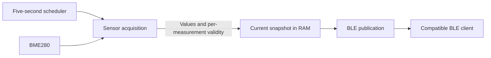

# Firmware Architecture

## Status and Responsibility

This is the target MVP design; see the [system architecture](README.md) and
[product requirements](../product/requirements.md). The current firmware is an
ESP-IDF CMake project with an empty `app_main`. Its configuration targets ESP32 and
enables NimBLE. Sensor acquisition and the application BLE service are not yet
implemented.

The firmware owns measurement production and local BLE availability. It measures
with continuous external power, regardless of whether Android or another client
is connected. It has no dependency on internet access or a backend.

## Logical Components

| Component | Responsibility |
| --- | --- |
| Startup and coordination | Initialize the sensor integration and BLE service, start sampling, and coordinate recovery without tying their lifetimes to a client. |
| Sensor acquisition | Read and interpret BME280 measurements through a driver boundary; distinguish valid values from acquisition or sensor failures. |
| Scheduler | Trigger measurements at the fixed five-second cadence, including when disconnected. |
| Current snapshot | Hold the latest acquisition outcome and each measurement's validity in RAM; provide a consistent handoff to BLE publication. |
| BLE publication | Advertise discoverability, serve the public measurement interface, and manage client connection resources through NimBLE. |

These are responsibility boundaries within the ESP-IDF firmware, not prescribed
tasks, files, or additional components. The exact sensor driver, bus integration,
task layout, and synchronization mechanism belong to implementation specifications.

## Acquisition and Publication

1. At startup, measurements are unavailable until a valid acquisition succeeds.
   BLE availability must remain recoverable if the sensor cannot initialize.
2. Each five-second acquisition updates the current snapshot with the outcome for
   temperature, relative humidity, and atmospheric pressure (MEAS-01).
3. Each measurement carries validity independently. A failed field is unavailable;
   valid fields may still be published. An acquisition-wide failure makes all
   affected fields unavailable (MEAS-04).
4. Publication exposes a consistent current outcome through the public BLE
   interface, preserving units and validity without inventing substitute values.
5. Subsequent valid acquisitions restore availability automatically. A phone does
   not need to reconnect to recover from a sensor failure.

The snapshot is a bounded current-state handoff, not a history queue. Sensor work
must not block BLE callbacks, and client backpressure or disconnection must not
stop the measurement schedule. BLE publication must not repeatedly present a
previously valid sample as newly measured after acquisition stops or fails. The
separate BLE specification must make this freshness behavior interoperable with
the Android 15-second expiration rule (MEAS-03, DOC-04).

## Connection and Failure Handling

The BLE service is readable without pairing or an authenticated phone. It provides
compatible-device discovery and the three measurements through a documented public
contract. The exact UUIDs, payload, update transport, and identity representation
remain to be specified. Current configuration alone does not define that contract.

A client disconnect releases its session resources and leaves the device available
for later connections. Serving concurrent clients is not required. Sensor failures
must preserve the distinction between a connected device with unavailable readings
and a device that cannot be reached over BLE.

Recoverable sensor and BLE errors must return to useful operation without routine
manual intervention. Initialization failures must not become an unrecoverable
one-shot path when the failed component becomes available later. Recovery timing
and individual operation timeouts require a separate implementation policy.

## Reliability and Verification

The target is seven consecutive days of measurement and BLE availability without
manual restart or recovery (REL-01). Keep connection resources and snapshot storage
bounded, release per-connection resources on disconnect, and avoid accumulating
samples or retry work. A reboot that interrupts operation is not evidence that
the uninterrupted reliability requirement has been met.

Measurements must not be persisted to flash, files, databases, or persistent logs,
or uploaded. Diagnostics must exclude measurement payloads from persistent logging
paths (DATA-02–03).

Verify five-second acquisition with and without a client, invalid and partially
valid samples, sensor failure and automatic recovery, disconnect/reconnect cycles,
and public access without pairing. Run the seven-day acceptance procedure from
the requirements with recorded revisions and hardware. An external test observer
may retain verification evidence; the product itself must not retain history.
